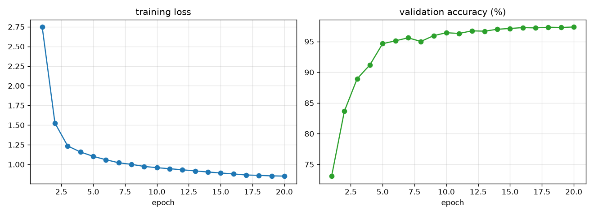
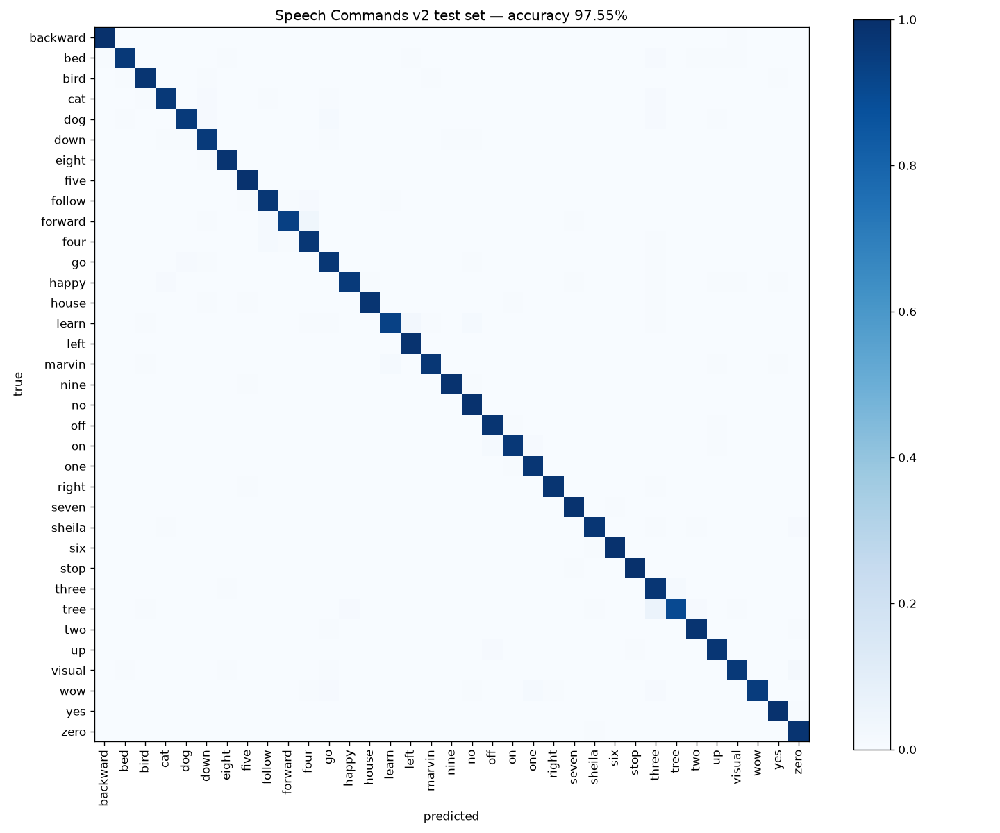

# Voice Recognition — Keyword Spotting with a CNN

A small deep-learning model that recognises **35 spoken words** from 1-second audio clips. It can classify `.wav` files or listen to a microphone in real time.

**Test accuracy: 97.55%** on the official Google Speech Commands v2 test set (11,005 clips from speakers never seen during training).

Words: `backward bed bird cat dog down eight five follow forward four go happy house learn left marvin nine no off on one right seven sheila six stop three tree two up visual wow yes zero`

## How it works

```
microphone / .wav  (1 s, 16 kHz = 16,000 samples)
        │
        ▼
log-mel spectrogram   40 mel bands × 101 frames  (25 ms window, 10 ms hop)
        │             sound becomes an "image" of frequency over time
        ▼
instance norm         volume-independent
        │
        ▼
SpecAugment           random frequency/time masks (training only)
        │
        ▼
CNN                   4 conv blocks (32→64→128→128) + global avg pool + dropout
        │
        ▼
softmax over 35 words → "left (93.5%)"
```

The main idea: once audio becomes a spectrogram, recognising a word is an **image classification** problem, so a normal CNN works well.

| Item | Value |
|---|---|
| Dataset | Google Speech Commands v2 (105,829 clips, 2,618 speakers) |
| Split | official lists: 84,843 train / 9,981 val / 11,005 test |
| Model size | 586,819 parameters (2.4 MB checkpoint) |
| Augmentation | ±100 ms time shift, background-noise mixing, SpecAugment |
| Training | AdamW, OneCycle LR (max 3e-3), label smoothing 0.1, 20 epochs, batch 256 |
| Training time | ~8.5 min on an RTX 5080 Laptop GPU |

## Results

| Metric | Value |
|---|---|
| Best validation accuracy | 97.36% |
| **Test accuracy** | **97.55%** |





Hardest words (per-class test accuracy): `tree` 90.2%, `learn` 93.2%, `forward` 93.5%, `wow` 95.2%, `dog` 95.9%.
Most of the `tree` errors are predicted as **`three`**, which is understandable since the two sound almost the same.
Full per-class numbers are in [`results/test_metrics.json`](results/test_metrics.json).

## Usage

```bash
pip install -r requirements.txt

# 1. Download the dataset (2.4 GB → 3.3 GB extracted)
mkdir -p data/speech_commands
curl -L -C - -o data/sc.tar.gz http://download.tensorflow.org/data/speech_commands_v0.02.tar.gz
tar -xzf data/sc.tar.gz -C data/speech_commands && rm data/sc.tar.gz

# 2. Train (or skip and use the included checkpoints/kws_cnn.pt)
python train.py --epochs 20

# 3. Evaluate on the test set (writes results/)
python evaluate.py
python plot_history.py

# 4. Predict words in .wav files
python predict.py samples/*.wav

# 5. Live microphone demo
python live_mic.py --threshold 0.7
```

Example output of `predict.py`:

```
samples/left.wav:  left (93.5%), yes (0.4%), eight (0.3%)
samples/seven.wav: seven (90.6%), bed (0.4%), zero (0.4%)
samples/stop.wav:  stop (89.8%), go (0.6%), cat (0.5%)
samples/yes.wav:   yes (91.6%), no (0.3%), up (0.3%)
```

(Top probabilities stay around 90% rather than 100% because of label smoothing during training.)

## Project structure

```
src/dataset.py     Speech Commands loader + augmentation
src/model.py       log-mel front end, SpecAugment, CNN
train.py           training loop (saves best checkpoint by val accuracy)
evaluate.py        test accuracy, per-class accuracy, confusion matrix
plot_history.py    training-curve plot
predict.py         classify .wav files
live_mic.py        real-time microphone keyword spotting
checkpoints/       trained model
results/           metrics and plots
samples/           4 test clips for a quick demo
```

## Ideas to extend

- Voice-control a robot: map `forward / backward / left / right / stop / go` to motion commands.
- Add an "unknown word" and "silence" class so random speech is rejected.
- Export to ONNX / TFLite and run it on a Raspberry Pi or ESP32.

## Credits

Dataset: P. Warden, *Speech Commands: A Dataset for Limited-Vocabulary Speech Recognition*, 2018, licensed under CC BY 4.0. The clips in `samples/` come from this dataset.
